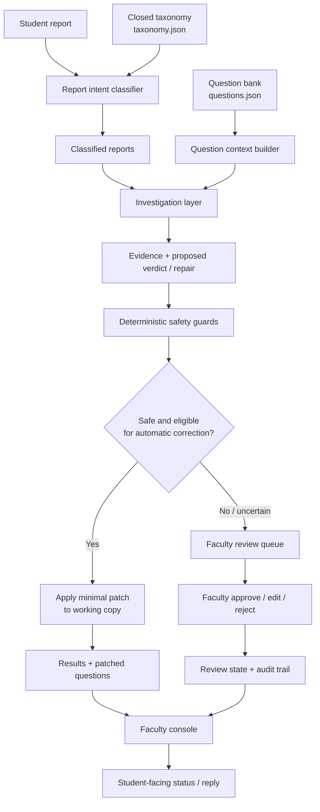
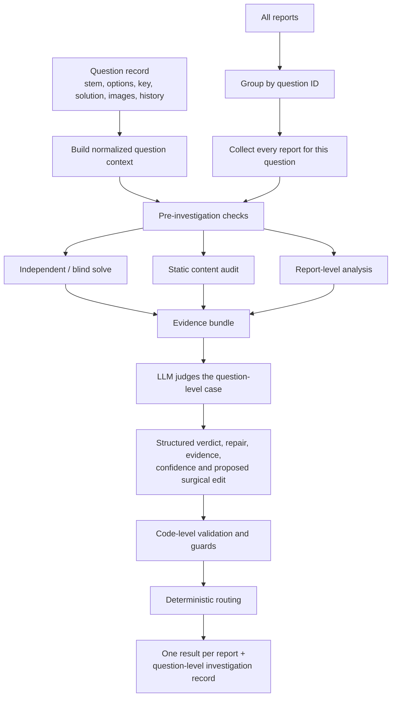
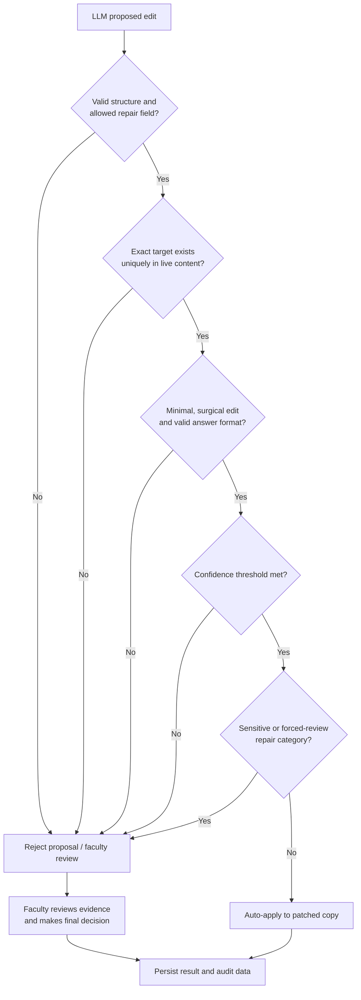
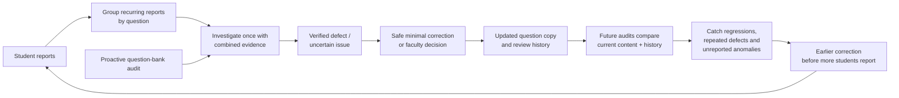
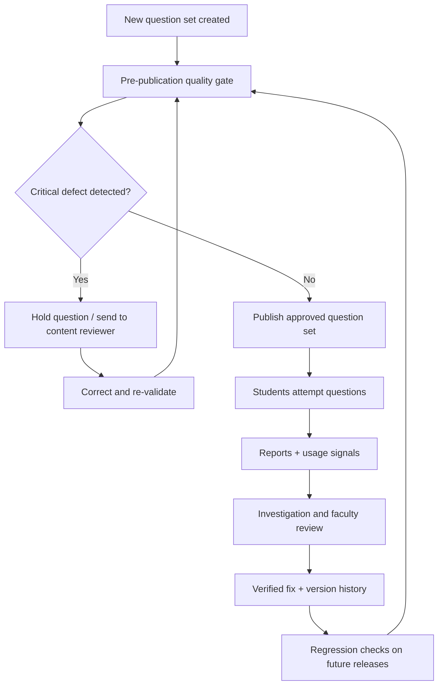
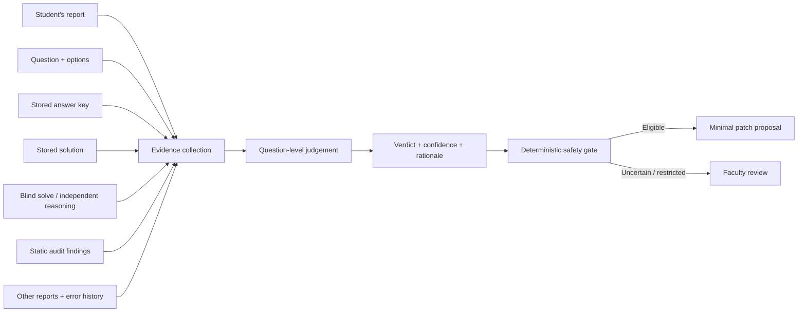
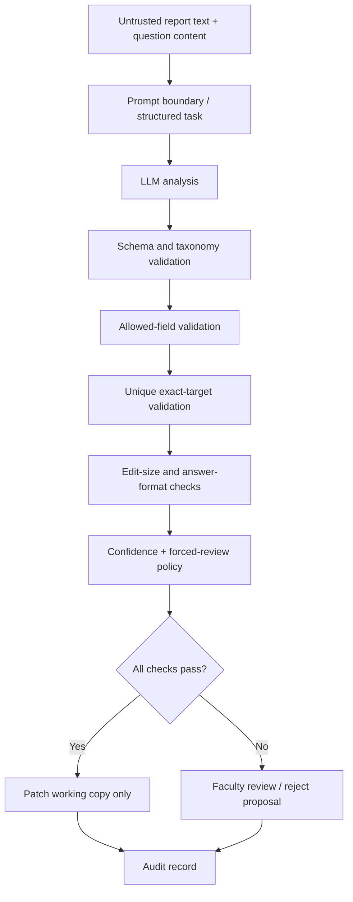

# Acadza — AI-Powered Question Error Triage & Faculty Review Console

Acadza serves students preparing for high-stakes examinations such as JEE and NEET. A question-bank defect—such as an incorrect answer key, missing value, blank option, or mismatched solution—can mislead many students before it is discovered.

This project explores a **Report → Verify → Review → Fix** workflow. It uses AI to investigate student-submitted error reports, proposes narrowly scoped corrections, and gives faculty a review console rather than treating a student's claim as proof.

> **Important:** This README documents the project based on the available source files and development notes. It does not claim that the current deployment, complete result set, or every endpoint has been independently re-tested as part of preparing this document.

## Project goals

- Distinguish genuine content defects from student misconceptions, display problems, app issues, and un-actionable reports.
- Verify a reported issue against the question, stored answer, stored solution, and independent reasoning.
- Propose minimal, evidence-backed edits instead of rewriting entire questions.
- Prevent the model from deciding by itself which changes are safe to apply.
- Route uncertain, high-impact, or human-authored content changes to faculty.
- Give faculty an auditable interface for reviewing proposed changes and student replies.

## Assignment data

The assignment dataset described in the supplied brief contains:

| File | Purpose |
|---|---|
| `questions.json` | 43 questions in Acadza's production-style format, including HTML and inline MathML. |
| `reports.json` | 44 student reports with report ID, question ID, student metadata, source, timestamp, and free-text comment. |
| `taxonomy.json` | Closed set of verdicts and repair types, including field permissions and automation rules. |

The question format contains type-specific data under `scq`, `mcq`, or `integerQuestion`. Options are embedded in question HTML rather than necessarily being represented as a separate options array.

## System overview


## Architecture diagrams

The diagrams below describe the intended data flow and safety boundaries. They are written in Mermaid, so GitHub can render them directly in the repository.

### 1. End-to-end system architecture



### 2. Investigation layer: one question, multiple evidence sources



### 3. Safety gate: the model recommends, code decides



### 4. Prevention loop: from today's report to fewer repeat reports



The final diagram represents the product's prevention strategy. The proactive checks, grouped investigation, guarded patching, and question-history checks are part of the documented investigation design. A dedicated dashboard for recurrence rates, question-health scores, and trend alerts is a proposed extension—not a claim that a complete analytics service is already implemented.

### 5. Question lifecycle: quality checks before and after publication



This is the proposed end-state workflow. The current assignment implementation concentrates on report classification, investigation, guarded patch proposals, and faculty review. A fully integrated pre-publication gate that blocks a live publishing workflow is a product direction, not something this README claims is already deployed.

### 6. Evidence matrix: why a report should not be judged on its wording alone



The key design choice is evidence triangulation. A strongly worded report is not automatically correct, and a report with poor wording is not automatically invalid. The investigator should compare independent evidence and the actual question content before assigning a verdict.

### 7. Defence in depth: contain a bad model output



This is a defence-in-depth model: no single prompt instruction is treated as a sufficient safety mechanism. Each later gate narrows what the system is allowed to do, and the original question bank remains the protected source of truth.


The implementation evolved through three milestones.

### 1. Student-report intent classification

`classifier.py` performs an initial classification using the student's comment and the supplied taxonomy. At this stage, it classifies the *kind of issue being reported*; it does not solve the question or decide whether the student is correct.

- Uses Groq through the OpenAI-compatible API.
- The configured model defaults to `openai/gpt-oss-120b`.
- Validates the returned label against the taxonomy.
- Uses `not_actionable` as the fallback for invalid or unclassifiable outputs.
- Writes `classified_reports.json` and `classification_debug.json`.
- Uses limited concurrency and retry/backoff handling for rate limits.

The project context records a successful 44-report classification run. The generated files in the working project should be checked before relying on that historical count.

### 2. Investigation and verification

`investigator.py` performs the deeper investigation. Its documented pipeline includes:

1. **Blind solving:** independently solve a question without relying on the stored answer key or solution.
2. **Content audit:** inspect question and solution content for structural or content anomalies, including possible defects not reported by students.
3. **Report investigation:** assess reports against the question, stored key, stored solution, independent reasoning, automated findings, and related reports for the same question.
4. **Deterministic guards:** validate proposed edits against field permissions, exact-match requirements, edit size, answer format, and other safety checks.
5. **Deterministic routing:** application code—not the LLM—decides whether an edit may be auto-applied or must go to faculty.
6. **Student replies:** prepare short, empathetic responses in an appropriate English/Hinglish style, with safeguards against claiming an unresolved issue has already been fixed.

The intended outputs include:

- `results.json` — assignment-facing result records.
- `investigation.json` — richer investigation details and guardrail outcomes.
- `patched_questions.json` — a copy of the questions with only eligible automatic edits applied.
- `prompts_dump.txt` — prompt material emitted by the investigator's prompt-dump option.

The exact contents and completeness of these generated outputs should be validated against all 44 source reports before submission.


### What makes the investigation layer different?

The classifier answers **“What kind of issue is the student describing?”** The investigation layer answers the more demanding question: **“Is there actually a defect in this question, what evidence supports that conclusion, and what is the safest next action?”**

It is designed around a question-level unit of work rather than treating every report as an isolated ticket:

1. **Group reports by question ID.** If several students flag the same question, the investigator brings those reports together. The model can compare the reports and their claims in one investigation instead of spending a separate full investigation on every duplicate report.
2. **Build a normalized question context.** The code extracts the question type, stem, options, stored answer, solution, image counts, and available error history. HTML and MathML are converted into a readable representation for reasoning, while source offsets are retained so a proposed text edit can be checked against the original content.
3. **Run checks before asking the model.** Deterministic pre-checks identify issues such as malformed answer-key formats, blank or duplicate options, missing parsed options, suspicious markup, possible stray text, references to absent diagrams, unusually short solutions, and previously logged faculty errors.
4. **Seek an independent answer.** The blind-solving step is intended to derive an answer without treating the stored key as ground truth. This creates an independent comparison point for answer-key disputes.
5. **Audit content proactively.** The static audit examines the question and solution even when a student has not explicitly identified that particular defect. This is important because a report-driven system can only react to problems that students notice and describe.
6. **Judge the combined evidence.** The LLM receives the question context, report comments, independent reasoning, and automated findings. It returns structured findings such as verdict, repair category, confidence, evidence, proposed edit, and student reply.
7. **Validate the proposal outside the model.** Deterministic code checks whether the edit is structurally valid, targets an allowed field, matches a unique exact substring, is appropriately narrow, and satisfies answer-format and confidence requirements.
8. **Route the case.** Application logic determines whether the proposal qualifies for automatic application or needs faculty review. Certain complex or human-authored content changes are deliberately held for a person.
9. **Apply only to a working copy.** Eligible changes are applied to `patched_questions.json`; the original source question bank remains untouched. Results and richer investigation records preserve the reasoning needed by the faculty console.

This separation is intentional: the LLM is used for reasoning and proposing, while deterministic code enforces the boundaries that protect the question bank.

### How the investigation layer helps prevent future reports

The goal is not merely to close the report currently in the queue. It is to find and correct the underlying content defect early enough that the next student does not encounter it.

**1. It can find defects before a student reports them.**  
The blind solve and static content audit inspect the question bank independently of the student's comment. For example, the code can flag a malformed answer key, a blank or duplicated option, a question that refers to a missing diagram, or a suspiciously short solution. These findings can be surfaced for review even if no report explicitly mentioned them. This changes the workflow from purely reactive support to proactive content-quality checking.

**2. It combines duplicate signals instead of investigating each one in isolation.**  
Reports are grouped by question ID and investigated together. If multiple students describe the same mismatch in different words, the combined evidence makes the common underlying issue easier to identify. It also avoids repeating the expensive investigation for every report on that question.

**3. It aims to fix the source, not just answer the reporter.**  
When a defect is verified, the system proposes a narrowly scoped correction to the question content or answer key. A corrected source question can prevent the same defect from affecting later students. The student reply is a separate output; sending a reassuring message without correcting the underlying content would not solve the product problem.

**4. It preserves history so known issues can be recognized.**  
The investigation code reads question-level `errorHistory` and incorporates previously logged faculty errors into its findings. This gives later investigations context about known or previously corrected problems. It can help distinguish a new issue from a recurrence and make regression checks more informed.

**5. It keeps uncertain fixes out of automatic publication.**  
A bad automated correction could create more reports than the original defect. Exact-match checks, field permissions, confidence thresholds, forced-review categories, and faculty approval paths reduce that risk. When the system cannot establish a safe correction, it escalates rather than guessing.

**6. It creates the foundation for question-health monitoring.**  
A natural next step is to aggregate investigation and review history into a question-health view: repeat reports per question, recurring repair categories, time-to-verification, unresolved cases, regressions after a correction, and defects found proactively rather than reported by students. This would let content teams prioritize questions that repeatedly create confusion or support load. The tracker and trend dashboard are a proposed product extension; they should not be confused with the current report-investigation pipeline.

In short, the prevention loop is:

> **Detect early → combine evidence → verify independently → correct safely → retain history → monitor recurrence.**

The system cannot guarantee that a question will never be reported again. It is designed to reduce repeat reports by identifying defects earlier, fixing verified root causes, and making recurring quality problems visible.


### The deeper prevention idea: move quality control upstream

A report-handling tool usually starts working only after a student has encountered a problem. That is necessary, but it is late in the lifecycle: the student has already lost time, confidence, or marks-related preparation time. The stronger product opportunity is to place the same verification capability *before publication*.

A practical rollout can happen in stages:

| Stage | What happens | Expected benefit |
|---|---|---|
| 1. Reactive triage | Classify and investigate incoming reports | Reduce manual sorting and give faculty evidence |
| 2. Question-level aggregation | Combine reports and error history by question ID | Identify repeated signals and avoid duplicate investigations |
| 3. Proactive audit | Run blind solving and static checks over a question set, even with no reports | Find obvious defects before students do |
| 4. Pre-publication gate | Hold high-risk questions until checks pass or a reviewer approves them | Prevent known defects from entering the student experience |
| 5. Regression monitoring | Recheck corrected questions when content changes and track recurring issue types | Catch reintroduced defects and prioritize weak content |

**A useful operational metric is escaped-defect rate:** the number of verified defects discovered after publication divided by the number of questions published in the same period. Pair it with verified auto-fix precision, faculty override rate, and median time-to-resolution. A system that auto-fixes more issues is not necessarily better if its precision falls or faculty must frequently undo its decisions.

The most important distinction is between *prevention* and *prediction*. The system does not need to predict which student will complain. It needs to systematically inspect every question, compare independent evidence, and stop or flag content that fails quality checks. Reports then become an additional signal that improves prioritization—not the only way a defect can be discovered.


### 3. Faculty review console

The documented console uses a FastAPI backend and an HTML/CSS/JavaScript frontend.

The intended faculty workflow includes:

- A queue grouped by question, so duplicate or related reports can be considered together.
- Native browser rendering of HTML and MathML question content.
- AI verdict, evidence, and proposed before/after changes.
- Approve, edit, reject, and reopen workflows.
- Audit entries for faculty decisions.
- A preview of the message that will be shown to the student.
- A student-facing report view and a way to submit a new report.

The project notes describe the following API routes:

| Method | Endpoint | Purpose |
|---|---|---|
| GET | `/api/questions` | Read question data |
| GET | `/api/reports` | Read investigation/report data |
| GET | `/api/results` | Read triage results |
| GET | `/api/state` | Read saved review state |
| POST | `/api/review` | Record a faculty review decision |
| POST | `/api/reopen` | Reopen a reviewed case |
| POST | `/api/reply` | Update a student-facing reply |
| POST | `/api/questions/{id}` | Save a question-level change |
| POST | `/api/reports` | Submit a new student report |

These routes are documented from the supplied development notes; confirm them against the current `server.py` before treating this table as a live API contract.

## Safety and product principles

- **A student comment is a lead, not an instruction.** Text in the report field is untrusted input and must never override system instructions.
- **The AI proposes; deterministic code enforces.** The model does not get final authority to auto-apply a change.
- **Field scope is enforced.** An edit must stay within the fields allowed for its repair category.
- **Edits should be surgical.** Text changes should target a unique, exact substring and make the smallest justified correction.
- **Uncertainty goes to a person.** Conflicting evidence, invalid edits, ambiguous questions, and human-authored academic content should be escalated.
- **Auditability matters.** Faculty decisions and overrides should be recorded separately from the original question and report data.
- **Source data should remain protected.** The documented architecture keeps the original question and report files read-only and stores review changes separately.

Some repair categories—such as diagrams, identical options requiring new distractors, unsound questions, mismatched question/solution pairs, chapter classification, and syllabus disputes—are intended for faculty review.

## Technology

- Python 3.12
- FastAPI and Uvicorn for the backend
- HTML, CSS, and vanilla JavaScript for the frontend
- Groq API using an OpenAI-compatible client
- `python-dotenv` for environment configuration
- JSON files for source data, generated results, and review-state persistence

Dependencies listed in the available `requirements.txt` include:

```text
google-genai
python-dotenv
groq
fastapi
uvicorn
```

The project notes describe Groq as the active provider after an earlier Gemini Flash experiment. Keep API credentials in a local environment file and never commit secrets.

## Expected project layout

The following is the layout described by the project notes. Adjust this documentation only if the actual repository layout differs.

```text
Acadza/
├── data/
│   ├── questions.json
│   ├── reports.json
│   ├── taxonomy.json
│   └── Context.json
├── frontend/
│   └── index.html
├── store/
│   └── review_state.json
├── classifier.py
├── investigator.py
├── server.py
├── results.json
├── investigation.json
├── classified_reports.json
├── classification_debug.json
├── prompts_dump.txt
├── requirements.txt
├── .env                 # local only; do not commit
├── README.md
├── PROMPTS.md
└── PRODUCT.md
```

## Setup

1. Use Python 3.12 or a compatible Python version.
2. Create and activate a virtual environment.
3. Install the dependencies:

   ```bash
   pip install -r requirements.txt
   ```

4. Place the three assignment JSON files in the configured data directory (`data/` by default).
5. Configure the required Groq API key and optional model/settings in a local `.env` file. Do not paste API keys into source code or commit the `.env` file.
6. Run the classifier when you need to regenerate intent classifications:

   ```bash
   python classifier.py
   ```

7. Run the investigation pipeline when you need to generate or refresh the investigation outputs:

   ```bash
   python investigator.py
   ```

8. Start the faculty console using the documented FastAPI command:

   ```bash
   uvicorn server:app --reload
   ```

9. Open `http://127.0.0.1:8000` in a browser.

> Run commands only after checking the current files and environment. The steps above describe the documented workflow; they are not a claim that the current local environment has been tested during preparation of this README.

## Product direction

The product strategy in `PRODUCT.md` focuses on the students who bear the greatest cost of broken questions, strict boundaries around AI automation, and verified auto-fix precision as the key first-week quality metric. A proposed extension is a question-health and recurrence tracker that identifies repeated reports and recurring content-quality problems.

## Documentation

- [`PROMPTS.md`](PROMPTS.md) — product prompt material, AI coding-assistant prompt history, known limitations in the available chat exports, and design decisions.
- [`PRODUCT.md`](PRODUCT.md) — product thinking, automation boundaries, monitoring metric, and an idea beyond the assignment.
- `Context.json` — persistent project context and development decision log.

## Current verification checklist

Before publishing the repository or submitting the assignment, verify:

- [ ] `results.json` contains one valid result for each of the 44 reports.
- [ ] Every `reportId` and `questionId` matches the source data.
- [ ] Every verdict and repair value is valid under `taxonomy.json`.
- [ ] Every proposed edit passes the deterministic safety checks.
- [ ] No human-review case is incorrectly marked `auto_apply`.
- [ ] The faculty console loads the real question, report, and result data.
- [ ] Faculty decisions persist and appear correctly in the student view.
- [ ] No API key, `.env`, private student information, or local cache is committed.
- [ ] The deployed URL and screen recording work for an evaluator.

## Status note

This README is a documentation draft based on the supplied Acadza assignment brief, project context, source files available in the conversation library, and the Antigravity prompt history supplied by the project owner. It intentionally avoids claiming that missing files, deployment, or the full end-to-end flow have been verified in this session.
